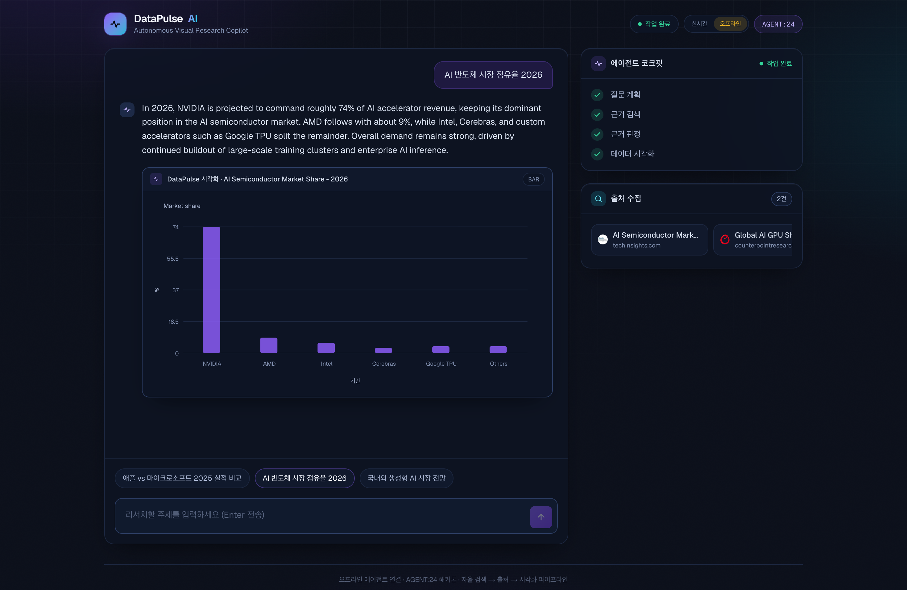
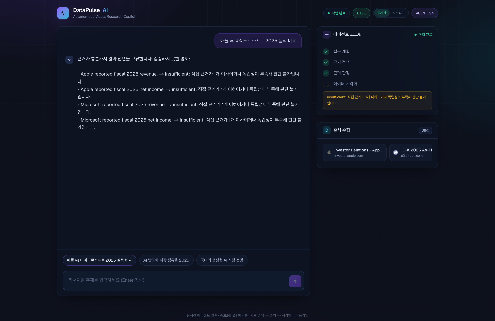

# DataPulse AI

> 근거가 없으면 답하지 않는 리서치 에이전트. 검색한 출처로 명제마다 근거를 판정하고, 모든 명제가 뒷받침될 때만 답변과 차트를 보여 줍니다.

🇺🇸 [English README](README.md)

## 이 레포에 대해

2026년 8월 AGENT:24 해커톤(Liner API 트랙) 제출작입니다. 제출 당시 버전은 git 태그 [`hackathon-submission`](../../tree/hackathon-submission)으로 남겨 두었습니다.
이후 커밋은 마무리하지 못한 부분을 정리하고 고친 것뿐입니다([해커톤 이후 변경 사항](#해커톤-이후-변경-사항) 참고).

프로젝트 기록으로 남겨 둔 레포입니다. 검색에는 [Liner](https://getliner.com) 플랫폼 API 키가 필요해서, 대부분은 오프라인 데모만 실행할 수 있습니다.

## 빠른 시작: 오프라인 데모 (키 없음)

Node.js 22 이상이 필요합니다.

```bash
git clone https://github.com/cynkai/datapulse-ai.git
cd datapulse-ai
npm install
npm run dev:mock   # 터미널 1: Liner API 로컬 mock, http://localhost:5001
npm run dev:web    # 터미널 2: 웹 UI, http://localhost:3000
```

http://localhost:3000 을 열고 오른쪽 위 토글을 **오프라인**으로 바꾼 뒤 데모 질문을 누릅니다.
오프라인 모드는 `mock/`에 준비된 답변을 브라우저로 바로 재생합니다. 안의 수치는 예시 데이터이지 리서치 결과가 아니며,
아래 에이전트는 관여하지 않습니다.



## 실시간 모드 (OpenAI + Liner 키)

```bash
cp agent/.env.example agent/.env   # OPENAI_API_KEY와 LINER_API_KEY 입력
npm run dev:agent  # 터미널 1: 에이전트 백엔드, http://localhost:4000
npm run dev:web    # 터미널 2: 웹 UI, http://localhost:3000
```

토글은 **실시간**에 둡니다. 웹 앱이 `/api/agent-run`을 통해 질문을 에이전트로 전달합니다.

| 변수 (`agent/.env`) | 기본값 | 의미 |
|---|---|---|
| `OPENAI_API_KEY` | (필수) | 에이전트와 근거 판정에 사용 |
| `LINER_API_KEY` | (필수) | Liner 검색 API |
| `OPENAI_MODEL` | `gpt-5.4-mini` | 판정 모델 (`OPENAI_JUDGE_MODEL`이 있으면 판정에만 그 값을 사용) |
| `LINER_BASE_URL` | `https://platform.liner.com` | Liner API 주소 |
| `ALLOW_MOCK_FALLBACK` | (꺼짐) | `true`면 Liner 호출이 실패할 때 로컬 mock을 사용하고, 결과에 `mock`으로 표시 |
| `PORT` | `4000` | 에이전트 포트 (웹 앱은 `AGENT_API_BASE`를 읽고, 기본값은 `http://localhost:4000`) |

### 실시간 실행 예시

2026-10-04에 데모 질문 "애플 vs 마이크로소프트 2025 실적 비교"로 확인했습니다(판정 모델 gpt-5.4-mini, 실행당 약 45~50초).
답변 보류를 적용한 뒤 세 번 실행했는데, 세 번 모두 적어도 한 명제에서 독립적인 직접 근거가 2개 미만이었습니다.
그래서 화면은 모델의 답변 대신 검증하지 못한 명제 목록을 보여 줬습니다.



보류를 적용하기 전에는 세 번 중 한 번이 모든 명제 `supported`로 끝나 애플 4,162억 달러 vs 마이크로소프트 2,817억 달러(2025 회계연도) 답변과 차트를 냈고,
나머지 두 번 중 한 번은 단서만 붙인 채 수치를 말했고, 한 번은 스스로 답을 거절했습니다. 판정도 모델이 하기 때문에 같은 질문도 실행마다 다르게 끝날 수 있습니다.

> **로컬에서 실행하세요.** 에이전트에는 인증도, 호출 제한도 없습니다. 키를 넣은 채 공개 배포하면 누구나 그 키를 쓸 수 있습니다.

## 동작 방식

에이전트(`agent/`, OpenAI Agents SDK)는 정해진 순서를 따르고, 단계마다 도구가 하나씩 있습니다.

1. **계획** (`plan_research`): 질문을 하위 질문으로 나누고(프롬프트상 최대 2개), 답이 되는 명제를 나열합니다.
   명제는 하나의 검증 가능한 사실이어야 하며, 요약·분류·추세는 거부합니다.
2. **수집** (`liner_search`): 하위 질문마다 Liner를 `scholar` 또는 `general` 모드로 검색합니다.
3. **판정** (`judge_evidence`): 명제마다 관련도가 높은 문단을 골라, 각 문단이 명제를 뒷받침하는지 반박하는지 모델에게 묻습니다.
   명제마다 `supported`, `conflicting`, `insufficient`, `unsupported`, `not_atomic` 중 하나의 판정이 붙습니다.
4. **결론:** 모델이 판정과 근거를 바탕으로 답변을 씁니다.
5. **시각화** (`render_visualization`): 필요한 명제가 모두 `supported`일 때만 차트를 그립니다.

이 규칙은 프롬프트에 맡기지 않고 코드로 강제합니다. 실시간 모드에서 웹 앱은 실행이 끝날 때까지 답변 문장을 붙잡아 두고,
판정된 명제가 하나 이상이면서 모두 `supported`일 때만 보여 줍니다. 아니면 "근거가 충분하지 않아 답변을 보류합니다"와 함께
검증하지 못한 명제, 판정, 판정 이유를 보여 줍니다. 차트도 같은 규칙을 따릅니다.
에이전트의 `/api/run` 스트림 자체는 거르지 않으므로, 다른 클라이언트는 이 규칙을 직접 적용해야 합니다.

검색 결과는 지시가 아니라 신뢰할 수 없는 데이터로 다룹니다. 모든 근거에 출처 종류(`live` 또는 `mock`)가 붙고,
화면에 답변이 어느 쪽을 썼는지 표시됩니다.

## 프로젝트 구조

```
agent/   리서치 에이전트 백엔드 (Node HTTP + SSE, OpenAI Agents SDK)
web/     Next.js UI. /api/agent-run이 에이전트로 전달
mock/    오프라인 데모와 테스트용 Liner API 로컬 mock
```

## 개발

```bash
npm test        # 에이전트·웹 단위 테스트 (키나 네트워크 필요 없음)
npm run lint
npm run build   # 웹 앱 프로덕션 빌드
```

## 해커톤 이후 변경 사항

- UI가 더 이상 쓰지 않던 초기 Liner 프록시 `server/`와 create-next-app 기본 README를 지웠습니다.
- 루트에서 `npm install` 한 번으로 전부 설치됩니다(npm workspaces). 에이전트가 `agent/.env`를 읽습니다.
- README를 코드에 맞게 다시 썼습니다.
- 제출 당시 실패하던 테스트 13개를 고쳤습니다. 6개는 에이전트가 처음 보내는 SSE 주석을 테스트 파서가 건너뛰기만 하면 됐고,
  웹 쪽은 실제 버그 두 개를 드러냈습니다. 실행이 `ok: true`로 끝나면 대기 중이던 Liner 출처 오류가 지워져서, 검색 결과가 없거나
  출처를 알 수 없는 답변도 실시간 결과처럼 끝났습니다. 또 브라우저를 닫아도 에이전트 실행이 멈추지 않았습니다.
- GitHub Actions CI와 MIT 라이선스를 추가했습니다.
- 실제 키로 검증하다가 실시간 실행을 망가뜨리던 버그 두 개를 찾았습니다. 웹 파서가 Agents SDK가 같은 도구 호출을 여러 번 보고하는 것을
  호출 ID 재사용으로 오인해, 모든 실제 실행이 "Liner 연결 실패"와 함께 출처 없이 끝났습니다. 또 계획 단계가 검색어를 긴 키워드 나열로 써서
  Liner가 본문 없이 출처만 돌려주는 바람에 모든 명제가 `insufficient`가 됐습니다. 이제 마지막 검색만이 아니라 모든 검색의 출처를 보여 줍니다.
- 개발 서버가 unpkg에서 버전 고정 없이 불러오던 디버깅 스크립트 두 개를 지웠습니다.
- "근거 없이는 답하지 않는다" 규칙을 화면에서 코드로 강제합니다. 판정된 명제가 모두 `supported`가 아니면 모델의 답변을 보류합니다
  (전에는 차트만 막고 답변 문장은 모델에 맡겼습니다). 나중의 판정 호출이 모두 `supported`여도 이미 막힌 차트가 다시 열리지 않습니다.

## 라이선스

[MIT](LICENSE)
